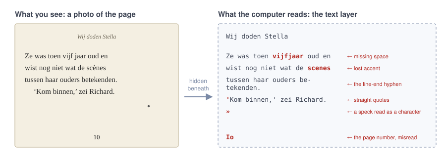
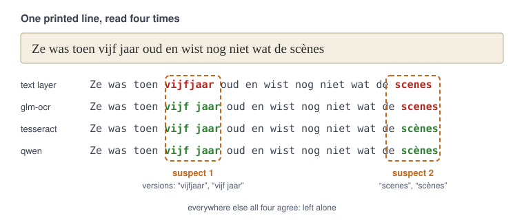
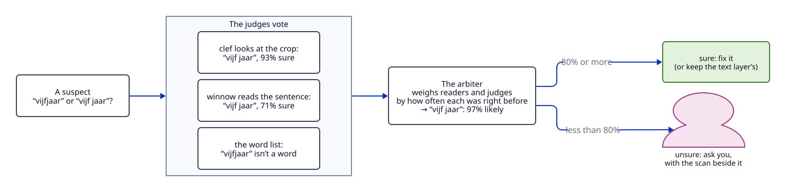
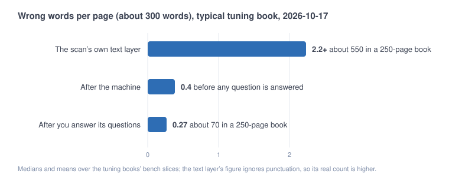
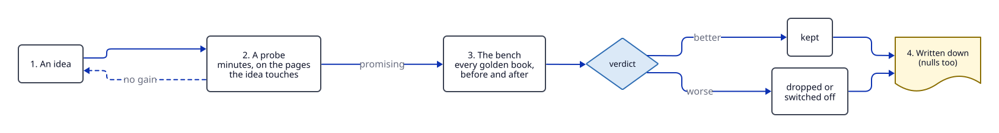

# Roboscriptorium from first principles

For anyone new to the project, or coming back to it after a while: what the machine
does, why it is built this way, how anyone can tell whether a change made it better,
and where the next gains are expected. It assumes no knowledge of the code.
[how-it-works.md](how-it-works.md) is the detailed tour of every stage;
[outlook.md](outlook.md) and `HANDOVER.md` have today's figures and what is running.

## What we're making, and why it's hard

You have a book as a PDF and you want an e-book (an EPUB): text that reflows on a phone,
with the book's own paragraphs, chapter headings, italics and quote marks, and no
leftovers from paper such as page numbers, running heads or words split by a hyphen at
the end of a line.

The bar is high. [Standard Ebooks](https://standardebooks.org) makes editions like that
by hand, and one book takes volunteers weeks of proofreading. The aim here is the same
care in a few hours of machine time, with a person answering only the few questions the
machine can't settle.

## What a scanned book really is

A scanned PDF is a stack of photos, one per page. To make the scan searchable, an OCR
program (optical character recognition: software that reads text off an image) read
each photo once and hid its reading underneath, in invisible ink. That hidden reading is
the **text layer**, and it is what you get when you copy text out of a scanned PDF.

The text layer is good, but not good enough. On a typical page of about 300 words it gets
two or three words wrong, more if you count punctuation: missing spaces, lost accents,
straight quotes where the book prints curly ones, a speck of dust read as a character,
"10" read as "Io". That is around 500 errors in an ordinary novel. The text layer also
knows nothing about structure: it doesn't say which line is a heading, which is a page
number, or where a paragraph starts.

So the job has two halves:

1. **Get every word right** (the reading half).
2. **Get the shape right**: paragraphs, headings, italics, quote marks, dashes (the
   structure half).

The project is about scans. A *born-digital* PDF, made straight from typeset text
(often by calibre, from an e-book), already holds exact text and converts back to an
e-book with existing tools, so it is out of scope.

## The core idea: read it again, with readers that fail differently

No OCR program is perfect, and a second one won't be either. But different programs
make *different* mistakes. One drops accents, another misreads quote marks, a third
glues words together. Where they all agree, the text is very probably right. Where
they disagree, something is worth a closer look.

So every line of the book is read again by three more **readers** (`readers.py`): two
AI models that look at a picture of the line (glm-ocr and qwen) and tesseract, a
classic OCR program. Each place where a reader disagrees with the text layer becomes a
**suspect**, and each way of reading it is a **version**. On a clean scan most lines
produce no suspect at all.

This is the main design choice of the whole project: **don't trust any one model;
combine several that fail in different ways, and learn how far to believe each.**

## Settling a suspect: judges, the arbiter and you

**Judges** look at each suspect and each picks a version:

- *clef* looks at the crop of the page and picks the version that matches what's
  printed. It is usually right.
- *winnow* reads only the sentence and picks the version that reads best. Alone it is
  a poor judge, but when it disagrees with clef, clef is wrong much more often, so it
  works as an alarm.
- *the word list* checks which versions are real words.

The judges are **decision models**: they don't write text, they answer a multiple-choice
question with a probability for each option. That is a deliberate rule in this project:
if the answer comes from a list known in advance, ask a model that picks from the list;
only ask a model to write text when new text is needed.

A judge saying "93% sure" doesn't mean it is right 93% of the time. So nobody takes the
judges at their word. The **arbiter** (`trust.py`) is a small model *trained* on
thousands of suspects from books where the correct text is known. It has learned how
often each reader and each judge was right, for each kind of difference (a quote mark,
an accent, a missing space), and it outputs one honest probability per version.

Then:

- if the arbiter is at least 80% sure of a version, it applies it (or keeps the text
  layer's, when that's the winner);
- if not, it **asks you**. The review page shows the question beside the scan, and one
  key answers it.

Your answers do two things: they fix this book, and they become more training examples,
so the arbiter gets better at the next one.

Asking isn't free. Your time is the scarcest thing in the project, and people make
mistakes too (about one answer in eight to ten, measured). So the machine asks only
where a question is likely to fix more than it costs: today around half a question a
page on a clean scan.

## The structure half

The other stages, in brief (how-it-works.md has each in detail):

- **The spotter** (a layout model) marks pictures, captions, titles and page furniture
  on each page image.
- **The sorter** decides what each line is: body text, a heading, a page number, a
  running head, junk to drop. Small trained models (decision trees) do most of it,
  with a decision model asked about doubtful lines.
- **Plain code** then joins lines into paragraphs (indents, short last lines, white
  space), decides whether a hyphen at a line end belongs to the word or only to the
  line break, finds italics from the slant of the letters, sets dashes, ellipses and
  quote marks the way the book prints them, and writes the EPUB.

The project prefers **learned decisions over hand-written rules**: a rule written for
one book tends to break the next one (one line-grouping rule that helped *Doctor
Dolittle* doubled the errors on another book). Where a trained model does the job at
least as well, it replaces the rule.

Everything runs **on this laptop** (Ollama serves the models). A hosted model costs
money and sends pages of copyrighted books to someone else's server, so it is only used
when you explicitly allow it.

## How we know whether it's any good: golden books

You can't improve what you don't measure, and you can't measure a book's errors
without knowing the right text. So the project keeps **golden books**: scans paired
with a text a person already checked, either a Project Gutenberg transcription or the
publisher's own e-book of the same printing. There are about 30, Dutch and English,
chosen to cover different kinds of trouble: clean modern novels, old typography,
pictures, washed-out scans.

The machine builds each golden book from its scan, lines its output up against the
reference, and counts the differences. Not every difference is the machine's fault: a
publisher's e-book sometimes corrects a word the print got wrong. Where it matters, a
person looks at the scan and records a **verdict** (what the page actually prints),
and the reference is patched with it.

### The main score

The headline number is **wrong words a page after review**: the errors left once you
have answered every question asked, plus a small charge for each question (your
expected slips, and your time: twenty questions are priced as one wrong word). It
captures both halves of the trade-off: fewer errors, and fewer questions.

On the clean, modern books (the kind the project targets first) it is now around one
wrong word every three to five pages. The busy and old books are worse, and a
washed-out scan still needs whole pages typed by a person.

The bench also counts **paragraph breaks set wrong** a page (now about 0.15) and
**headings found**, because a book whose words are right but whose paragraphs are
jumbled isn't right.

### Three sets, so we don't fool ourselves

If you tune a machine on the same books you score it on, it learns those books and
the score flatters it. So the golden books are split, as in any machine-learning
project:

| Set | Used for | Like… |
| --- | --- | --- |
| **tuning** (16 books) | choices are made on it, and the arbiter learns from it | studying with past exams |
| **validation** (7 books) | only vetoes: a choice no better on tuning isn't taken for a gain here | a mock exam |
| **first look** (6 books waiting) | a new book scored **once**, touched by nothing before it; then it joins tuning or validation | the real exam, sat by every new book |

Even inside tuning, each book is scored by an arbiter trained *without* that book, so
it never grades its own homework. A first look says how the machine does on a book it
has never seen, which is the question the whole project asks; with a new one every
time a pair is added, that question keeps getting asked instead of being answered once.

## How a change earns its place

Every improvement goes through the same loop.

1. **An idea**, usually from looking at the errors that are left: "most remaining errors
   are at line ends; a model that reads the whole page might catch them".
2. **A probe**: a quick experiment (minutes to an hour) on just the pages the idea
   touches. Does it fix more than it breaks? Most ideas die here, and that's the point:
   a probe is cheap, a full run is not. The scripts are in `experiments/`, named
   `probe_*.py`.
3. **The bench** (`roboscriptorium bench tuning`, then `validation`): every golden book
   built before and after the change, compared page by page.
4. **Written down**: what was tried, the numbers and the verdict go into
   [decisions.md](decisions.md); the running summary of what helped and what didn't is
   in [outlook.md](outlook.md). Failed ideas are recorded too, so nobody tries them
   again without a new reason.

### Reading a bench result

The other session's reports are full of lines like this:

> tuning NO CHANGE, 0.32 → 0.32; validation BETTER, breaks 0.16 → 0.13 [−0.06, −0.01]

Decoded:

- **0.32 → 0.32**: wrong words a page after review, before and after the change,
  averaged over the set with every book weighing the same.
- **[−0.06, −0.01]**: the range the true difference probably lies in (a 95% interval,
  computed by resampling the pages). Both ends below zero means it really went down;
  a range that straddles zero means the difference could be luck.
- **BETTER**: the main score improved and nothing got clearly worse. **NO CHANGE**: the
  difference is within the noise. **WORSE**: clearly worse.
- **vetoed**: better on average, but one book got clearly worse. A change that helps
  most books and wrecks one is rejected, because the next real book might be like the
  one it wrecked.

Why the fuss: a single run's score moves by more than most changes do. Only comparing
the same pages before and after, with an interval, separates a real gain from luck.

### Why runs take hours, and "cold" and "warm"

A model reading one line takes about a second; one page with everything on it takes
about a minute. A full bench over every golden book is a few thousand pages.

Every model's answer is saved (cached) under `work/`. A **warm** run reuses those answers
and finishes in minutes; it is possible when the change sits *after* the models, such
as a new paragraph rule. A **cold** run has to ask the models again, because the change
sits *before* them (a new prompt, a new crop, a new model). Cold runs take hours, so
they run overnight. That is also why upstream changes are first chosen on small frozen
sets of lines (`tryouts/`, run by `experiments/tryout.py`) before anything cold runs.

## Where the remaining errors are, and how we expect to improve

### What we learned about the errors that are left

The most important finding so far: **most of the errors that survive review were never
suspects.** All the readers read the same wrong thing, so nothing raised a question.
A better arbiter or better judges can't touch those; they never see them. Many sit at
the joins between lines (a hyphen that belonged to the word, two words glued across a
line break, a page number left in) because each reader sees one line at a time.

That points to the bets below, roughly by expected gain.

### The bets

1. **Reading whole pages instead of single lines.** A model that sees the whole page
   sees the line joins. As a ceiling test, Claude read 17 pages with one real error,
   including at every kind of place the pipeline still gets wrong. The local models
   aren't there yet: qwen reading whole pages made 76 wrong words over 19 test pages,
   where the current pipeline makes 27. Feeding today's page readings in as extra readers
   didn't help either (tried for a night, no change). So the architecture to aim for
   is known; the bottleneck is how good the local vision models are. **Each new model
   gets screened on the frozen sets**, and the machine is built so that a better model
   can take over a role quickly.
2. **Structure**: paragraph breaks in books that don't indent paragraphs, headings
   still missed (drawn numerals, old-style figures, titles that also appear as running
   heads), verse, tables and block quotes not handled yet.
3. **Fewer, better questions.** You answer until you're tired, so a question that
   fixes nothing costs as much as an error. Untried ideas: one answer for the same
   question across pages ("is this `|` an `I`?" once, not forty times), and ranking
   questions by errors fixed per second of your time.
4. **Better pixels.** The readers see heavily compressed scans. The Internet Archive
   keeps sharper page images for public-domain books; whether they help is untested.
5. **The hard tail**: washed-out pages that no model reads. A person types them, or the
   book is rescanned.

### What has been tried and didn't help

So you can recognise a rerun of an old idea. Details and numbers in outlook.md's "Tried,
and why it didn't help".

- Rewording qwen's instructions, or giving it bigger, sharper or wider crops.
- A third judge, or a model judging paragraph breaks from a crop of a few lines: it
  broke as many breaks as it fixed.
- Faster or differently packaged reader models: worse on quote marks, or no more
  accurate.
- Fine-tuning a reader: ruled out by measurement, since only about 30% of what's left
  is the kind of reading error a better reader alone would fix.
- Speeding up qwen with parallel requests: the runtime handles one at a time.

## What is going on right now (2026-10-17)

`HANDOVER.md` always has the current state; this is what it said when this page was
written, decoded.

- **Growing the short tuning slices.** Seven tuning books are scored on only 10–25 pages
  each, which makes the bench's verdicts on them noisy. An overnight run reads more of
  their pages. It is expected to make the measurement surer, not the books better; a
  test on 2026-10-12 showed more pages teach the arbiter little.
- **Waiting to merge behind it**: a fix to how headings are counted (a number and a
  title set on two lines counted as one heading), the sorter learning numbers misread
  as letters ("Io" for 10), and a doc cleanup. They wait so that one bench measures
  them on the grown slices.
- **Then**: the arbiter retrained on the grown slices, and both benches.
- **For you**: six new questions on *Ex-minnaar*, then reading it through, then
  *Wij doden Stella*, the book the project targets first.

Good questions to ask the other session about any run, to stay in touch with it: *what
do you expect it to show? what would make you drop the idea? which file will the result
go in?* If the answer to the first is "a surer number" rather than "fewer errors",
that's a measurement run, not an improvement.

## A glossary

| Word | Means |
| --- | --- |
| text layer | the scan's own hidden OCR reading; the starting point |
| reader | a model or program that reads text off the image (glm-ocr, tesseract, qwen) |
| suspect, version | a place where readings differ; each way of reading it |
| judge | a model that picks a version (clef, winnow, the word list) |
| arbiter | the trained model that weighs readers and judges and fixes, keeps or asks |
| spotter | the layout model that marks pictures, captions and titles |
| sorter | what decides each line's role: body, heading, page number, junk |
| decision model | a model that picks from fixed options with probabilities; writes no text |
| generative model | a model that writes text (the readers) |
| trust data | suspects from golden books labelled right or wrong; what the arbiter learns from |
| golden book, pair, reference | a scan plus a checked text of the same edition |
| verdict | a person's ruling on what the scan prints where output and reference differ |
| slice | the pages of a golden book the bench scores |
| tuning, validation, test | the three sets of golden books (above) |
| bench | the paired before/after comparison over a set; it decides whether a change stays |
| after review | wrong words a page once every question is answered, with questions charged |
| unasked | errors no question points at; what the reviewer can't catch |
| breaks | paragraph breaks set wrong, a page |
| probe | a quick experiment on a few pages, before building anything |
| null | a probe or bench that showed no gain; recorded anyway |
| cold, warm | a run that has to ask the models again, or one that reuses their saved answers |
| frozen set, tryout | a fixed set of lines for comparing models or prompts in minutes |
| CER, WER | character and word error rate: the share of characters or words that are wrong |
| retired | a golden book dropped because its reference turned out to be another edition |
