# Roboscriptorium, explained

For anyone new to the project, or coming back to it: what the machine does, why it is
built this way, how a change is judged, and where the next gains are expected. It
assumes no knowledge of the code. [how-it-works.md](how-it-works.md) tours every stage
in detail; [outlook.md](outlook.md) and `HANDOVER.md` have today's figures and what is
running.

## What we're making, and why it's hard

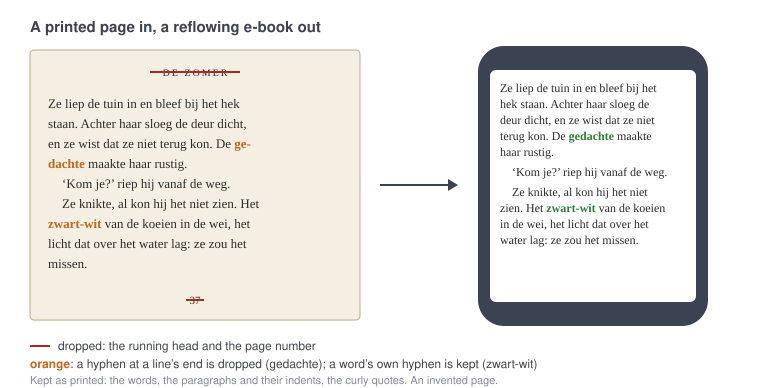

You have a book as a PDF and you want an e-book (an EPUB): text that reflows on a phone,
with the book's own paragraphs, chapter headings, italics and quote marks, and no
leftovers from paper such as page numbers, running heads (the title repeated at the
top of each page) or words split by a hyphen at the end of a line.

The bar is high. [Standard Ebooks](https://standardebooks.org) makes editions like that
by hand, and one book takes volunteers weeks of proofreading. The aim here is the same
care in a few hours of machine time, with a person answering only the few questions the
machine can't settle.

## What a scanned book really is

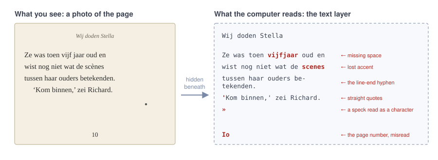

A scanned PDF is a stack of photos, one per page. To make the scan searchable, an OCR
program (optical character recognition: software that reads text off an image) read
each photo once and hid its reading underneath, in invisible ink. That hidden reading is
the **text layer**, and it is what you get when you copy text out of a scanned PDF.

The text layer is good, but not good enough. On a typical page of about 300 words it gets
two or three words wrong, more if you count punctuation: missing spaces, lost accents,
straight quotes where the book prints curly ones, a speck of dust read as a character,
"10" read as "Io". That is around 500 errors in an ordinary novel. The text layer also
knows nothing about structure: it doesn't say which line is a heading, which is a page
number, or where a paragraph starts.

So the job has two halves:

1. **Get every word right** (the reading half).
2. **Get the shape right**: paragraphs, headings, italics, quote marks, dashes (the
   structure half).

The project is about scans. A *born-digital* PDF, made straight from typeset text
(often by calibre, from an e-book), already holds exact text and converts back to an
e-book with existing tools, so it is out of scope.

## The ideas behind the machine

Everything below follows from five ideas.

1. **The print, faithfully.** The book's own words, spelling, paragraphs and
   typography: its dashes, its ellipses, its quote marks. No house style. The machine
   fixes reading errors, never the author; a misprint is corrected only where you mark
   it.
2. **Don't trust any one model.** Combine several that fail in different ways, and
   learn how far to believe each.
3. **Learned, not hand-written.** A rule written for one book tends to break the next
   (one line-grouping rule that helped one book doubled the errors on another). Where a
   model trained on checked examples does a job at least as well, it replaces the rule.
4. **Your time is the scarcest thing.** The machine asks only what it can't settle,
   and only once it has done all it can.
5. **Measured, not believed.** Every change is scored on books whose correct text is
   known, before and after, and kept only if the score says so.

Everything runs **on this laptop** (Ollama serves the AI models). A hosted model costs
money and sends pages of copyrighted books to someone else's server, so it is used
only when you explicitly allow it.

## Reading it again, with readers that fail differently

No OCR program is perfect, and a second one won't be either. But different programs
make *different* mistakes. One drops accents, another misreads quote marks, a third
glues words together. Where they all agree, the text is very probably right. Where
they disagree, something is worth a closer look.

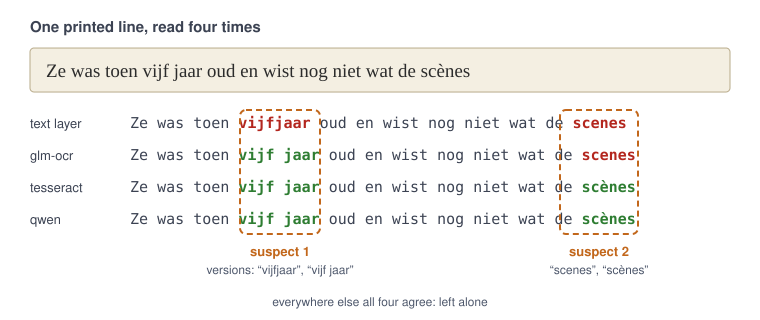

So every line of the book is read again by three more **readers**: two AI models that
look at a picture of the line (glm-ocr and qwen) and tesseract, a classic OCR program.
Each place where a reader disagrees with the text layer becomes a **suspect**, and each
way of reading it is a **version**. On a clean scan (sharp print, no stains or
fading) most lines produce no suspect at all.

## Settling a suspect: judges, the arbiter and you

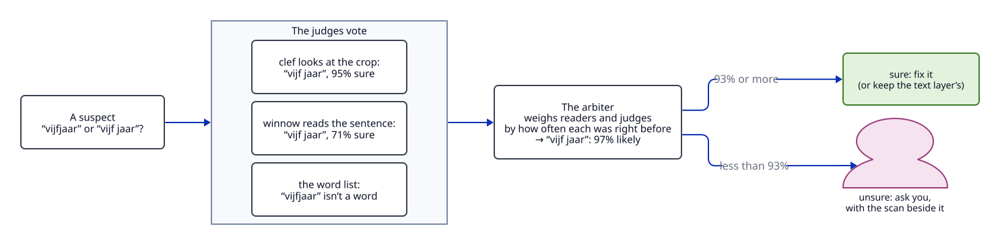

**Judges** look at each suspect and each picks a version. They look at different
things, so they go wrong in different places:

- **The picture.** *clef*, *autotrust-jev* and *d3*, three AI models of different
  families, look at a crop of the page and pick the version that matches what's printed.
  None is much better than the others alone; together they leave about a seventh fewer
  **silent errors** (wrong words that reach the book with no question pointing at them),
  because each goes wrong where the others don't.
- **The sentence.** *winnow* reads only the sentence, without the picture, and picks the
  version that reads best. Alone it is right four times in five, less than clef, but
  where it disagrees with clef, clef is wrong much more often, so it works as an alarm.
  A smaller *autotrust-jev* reads the sentence too; its mistakes fall elsewhere, and it
  saves about one question in a hundred without letting more errors through.
- **The ink.** *render and compare* is no AI model and knows no language: it draws each
  version in the book's own typeface and checks which drawing covers the scan's ink
  (below).
- **The dictionary.** *the word list* checks which versions are real words.

Why a judge that can't read? Every other judge leans on what a word ought to be, so
they make the same mistakes where the print is unusual: a speck of dust that looks like
a mark, small capitals, an accent, a full stop pressed against a comma. Render and
compare looks only at ink. Once per book it finds the book's typeface, by drawing
sample words in every font of a library of type and keeping the one that lies best over
the scan. Then, for each suspect, it draws every version in that typeface at the book's
size, lays each drawing over the ink at that place and votes for the one that fits
best.

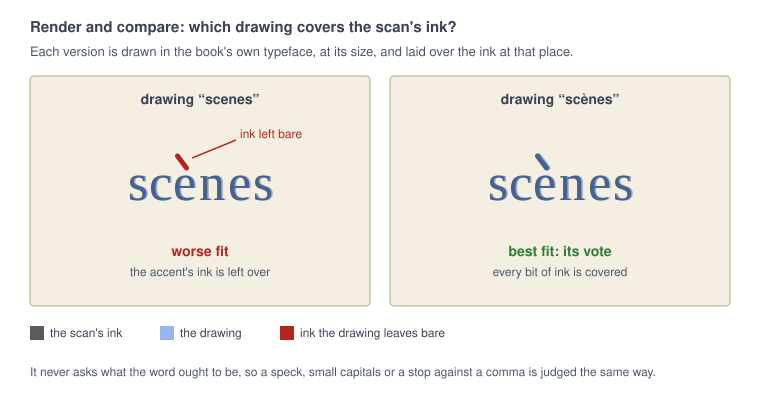

On the golden books (books whose correct text is known; more on them below) its pick
is the printed version about nine times in ten, and it gets most of the other judges'
misses right; with its vote the machine lets fewer errors through, however many
questions it asks you. It is weakest where the library lacks the book's typeface.

One more kind was tried and is off: a **context judge** (qwen, thinking before it
answers) read the sentences around a question the arbiter would ask, and settled it
when it agreed with the arbiter's own likeliest version. It saved about one question
in eight, but let a few more errors through unasked, and you chose fewer silent errors
over fewer questions.

The judges are **decision models**: they don't write text, they answer a multiple-choice
question with a probability for each option. That is a deliberate rule in this project:
if the answer comes from a list known in advance, ask a model that picks from the list;
only ask a model to write text when new text is needed.

A judge saying "93% sure" doesn't mean it is right 93% of the time. So nobody takes the
judges at their word. The **arbiter** is a small model *trained* on thousands of
suspects whose right answer is known: those in the golden books, and the places you
answered yourself in past reviews. It has learned how often each reader and each judge
was right, for each kind of difference (a quote mark, an accent, a missing space), and
it outputs one honest probability per version.

Then:

- if the arbiter is at least 93% sure of a version, it applies it (or keeps the text
  layer's, when that's the winner);
- if not, it **asks you**. The review page shows the question beside the scan, and one
  key answers it.

Your answers do two things: they fix this book, and they become more training examples,
so the arbiter gets better at the next one.

Asking isn't free. People make mistakes too (about one answer in eight to ten,
measured), and every question costs you time. So the machine asks only where a question
is likely to fix more than it costs: about one question every two pages on a clean
scan.

## The structure half

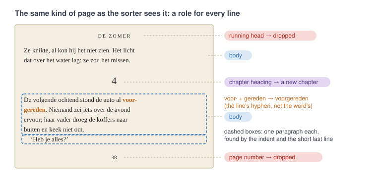

The other stages, in brief:

- **The spotter**, a layout model, marks pictures, captions and titles on each page
  image, and the furniture of the page: page numbers, running heads.
- **The sorter** decides what each line is: body text, a heading, a page number, a
  running head, junk to drop. Small trained models (decision trees: chains of yes/no
  questions learned from examples) do most of it, with a decision model asked about
  doubtful lines.
- **Paragraphs**: plain code joins lines into paragraphs from indents, short last
  lines and white space.
- **Line-end hyphens**: is the hyphen part of the word (*zwart-wit*) or only a break
  (*zwart-* / *heid*)? The book's own other uses and the word list settle most. For the
  rest, judges say how the word is spelled, and a small trained model weighs their
  answers against the book's habits.
- **Typography and italics**: dashes, ellipses and quote marks are set the way the book
  prints them. Italics come from the slant of the letters, read by two sets of decision
  trees; where they disagree (about one word in a thousand) clef is shown the word's
  line and decides (your idea; it left a fifth fewer italic errors).

Then the EPUB is written.

## Golden books: how we know a change helps

Most ideas sound good, and most don't help. What tells them apart is a set of **golden
books**: scans paired with a text a person already checked, either a Project Gutenberg
transcription or the publisher's own e-book of the same printing. There are about 30,
Dutch and English, chosen to cover different kinds of trouble: clean modern novels, old
typography, pictures, washed-out scans.

They are the project's feedback loop, and they do three jobs:

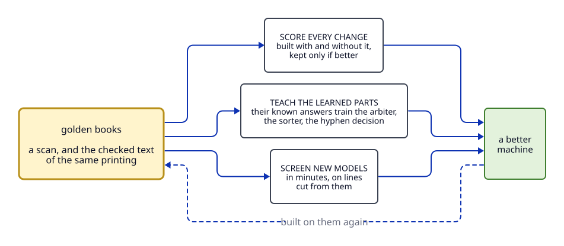

- **They score every change.** The machine builds each golden book with and without a
  change and counts its differences from the checked text; the change stays only if
  the count goes down. An idea gets a verdict in hours, not an impression.
- **They teach.** Their known answers are the examples the learned parts train on: the
  arbiter, the sorter, the line-end hyphen decision. "Learned, not hand-written" works
  only because these examples exist.
- **They screen new models.** Small frozen sets of lines cut from them let a new model
  be compared with the one in a role in minutes.

Without them, "this looks better" would be the only test, and a fix for one book could
quietly break another. They also outlast everything else: code gets rewritten and
models get replaced, but a golden book with its checked text carries over to whatever
comes next.

### How a golden book scores a build

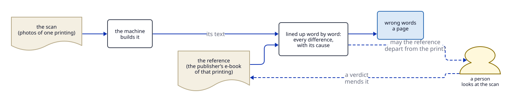

A golden book only works if its text really is that printing's: one from another
edition would count every difference between the editions as the machine's error. So
each one is checked against its scan, and dropped if its text turns out to be another
edition's.

The machine builds each golden book from its scan, lines its output up against the
reference, and counts the differences. Not every difference is the machine's fault: a
publisher's e-book sometimes corrects a word the print got wrong. Where it matters, a
person looks at the scan and records a **verdict** (what the page actually prints),
and the reference is patched with it.

Scoring a whole set of golden books this way, once with a change and once without, is
a **bench**.

### The main score

The headline number is **wrong words a page after review**: the errors left once you
have answered every question asked, plus a small charge for each question (your
expected slips, and your time: twenty questions are priced as one wrong word). It
captures both halves of the trade-off: fewer errors, and fewer questions.

On the golden books the machine is tuned on, the text layer's two or three wrong words
a page come down to about 0.7 once the readers and judges are done, and to about 0.2
after your review: one wrong word every five pages. Busy layouts and old typography do worse, and a
washed-out scan still needs whole pages typed by a person.

The bench also counts **paragraph breaks set wrong**, **headings** found or lost, and
**italics**, because a book whose words are right but whose paragraphs are jumbled
isn't right.

### Three sets, so we don't fool ourselves

If you tune a machine on the same books you score it on, it learns those books and
the score flatters it. So the golden books are split:

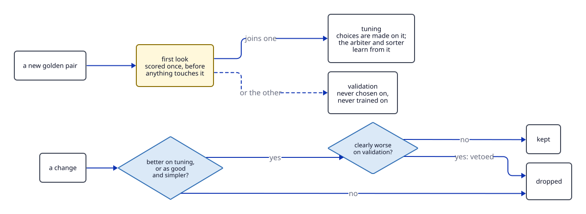

| Set | Used for | Like… |
| --- | --- | --- |
| **tuning** (about 20 books) | choices are made on it, and the arbiter learns from it | studying with past exams |
| **validation** (about 10 books) | a held-back pile never decided on, there to catch a change that only helps the books it was tuned on: it can only turn a yes into a no | a mock exam |
| **first look** | a new book scored **once**, touched by nothing before it; then it joins tuning or validation | the real exam, sat by every new book |

The order follows from that. A change is first benched on tuning against a **control**:
the same build made the same way without the change. Only if tuning shows a gain does
validation run; a change with no gain on tuning ends there, since validation could only
say no.

A first look says how the machine does on a book it has never seen, which is the
question the whole project asks; with a new one every time a golden book is added, that
question keeps getting asked instead of being answered once.

### How the learned parts are trained

Training means: gather examples whose right answer is known, let a model find the
pattern in them, and save the result as a file that every build then uses. The arbiter
is the main one; the sorter and the line-end hyphen decision are trained the same way on
examples of their own.

The arbiter's examples are the **trust data**. Every tuning book is built, and at each
suspect it records what every reader read, which version every judge picked, and which
version matches the checked text. Your review answers on books with no checked text are
added the same way. Training on all that takes about an hour and a half: once on every
tuning book, for the arbiter the builds use, and once more per tuning book with that
book left out, so the bench never scores a book with an arbiter that has seen it.

Two things follow:

- **A new reader or judge waits for its votes.** The arbiter can only weigh a judge
  whose votes are in the trust data. So a new judge first answers every suspect of every
  tuning book (tens of thousands of questions, many hours for a large model); only then
  is the arbiter retrained and the change benched.
- **A retrained arbiter is compared with a control retrained beside it.** Retraining
  moves the results on its own: the examples shift a little every time the trust data is
  rebuilt. So the control is trained the same way, on the same examples, without the
  change, and the difference between the two belongs to the change alone.

## How a change earns its place

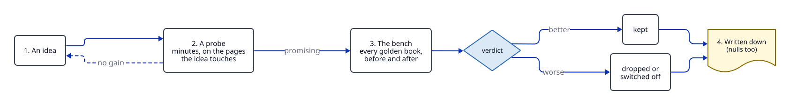

Every improvement goes through the same loop.

1. **An idea**, usually from looking at the errors that are left: "most remaining errors
   are at line ends; a model that reads the whole page might catch them".
2. **A probe**: a quick experiment (minutes to an hour) on just the pages the idea
   touches. Does it fix more than it breaks? Most ideas die here, and that's the point:
   a probe is cheap, a full run is not.
3. **The bench**: tuning, then validation, every book built with and without the
   change and compared page by page.
4. **Written down**: what was tried, the numbers and the verdict go into
   [decisions.md](decisions.md); the running summary of what helped and what didn't is
   in [outlook.md](outlook.md). Failed ideas are recorded too, so nobody tries them
   again without a new reason.

### Reading a bench result

Bench results are reported in lines like this:

> tuning NO CHANGE, 0.32 → 0.32; validation BETTER, breaks 0.16 → 0.13 [−0.06, −0.01]

Decoded:

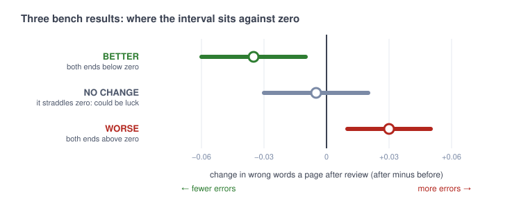

- **0.32 → 0.32**: wrong words a page after review, before and after the change,
  averaged over the set with every book weighing the same.
- **[−0.06, −0.01]**: the range the true difference probably lies in (a 95% interval,
  computed by resampling the pages). Both ends below zero means it really went down;
  a range that straddles zero means the difference could be luck.
- **BETTER**: the main score improved and nothing got clearly worse. **NO CHANGE**: the
  difference is within the noise. **WORSE**: clearly worse.
- **vetoed**: better on average, but one book got clearly worse. A change that helps
  most books and wrecks one is rejected, because the next real book might be like the
  one it wrecked.

A single run's score moves by more than most changes do. Only comparing the same pages
before and after, with an interval, separates a real gain from luck.

### Why runs take hours, and "cold" and "warm"

A model reading one line takes about a second; one page with everything on it takes
about a minute. A full bench over every golden book is a few thousand pages.

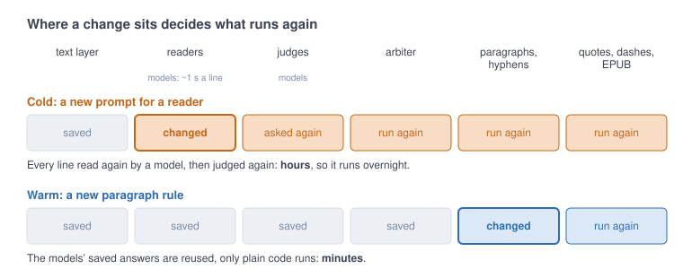

Every model's answer is saved (cached). A **warm** run reuses those answers and
finishes in minutes; it is possible when the change sits *after* the models, such as a
new paragraph rule. A **cold** run has to ask the models again, because the change sits
*before* them (a new prompt, a new crop, a new model). Cold runs take hours, so they
run overnight. That is also why changes before the models are first chosen on **frozen
sets**: small fixed sets of lines, where models or prompts compare in minutes, before
anything cold runs.

### Questions to ask about any run

To follow what's running without reading the code: *what do you expect it to show? what
would make you drop the idea? which file will the result go in?* If the answer to the
first is "a surer number" rather than "fewer errors", it's a measurement run, not an
improvement.

## Where the remaining errors are, and how we expect to improve

### What we learned about the errors that are left

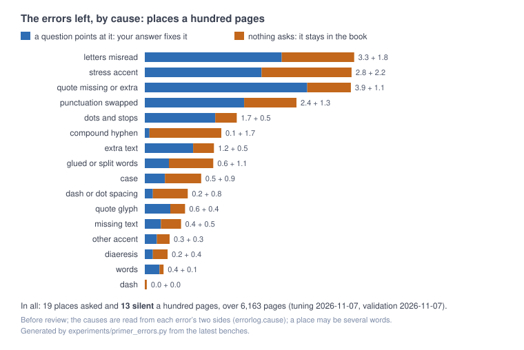

Every error the bench finds is saved with a **cause** read from its two sides (a quote
missing, letters misread, words glued together, a hyphen in a compound word…), so each
run says not only how many errors are left but which kinds. The orange part of each bar
is what stays in the book after your review. Some causes are never asked about at all:
a compound word's hyphen lost or added (*zwart-wit* against *zwartwit*), the spacing
around a dash.

The most important finding so far: **most of the errors that survive review were never
suspects.** All the readers read the same wrong thing, so nothing raised a question.
A better arbiter or better judges can't touch those; they never see them. Many sit at
the joins between lines (a hyphen that belonged to the word, two words glued across a
line break, a page number left in) because each reader sees one line at a time.

That points to the bets below, roughly by expected gain.

### The bets

1. **Reading whole pages instead of single lines.** A model that sees the whole page
   sees the line joins. As a ceiling test, Claude read 17 pages with one real error,
   including at every kind of place the machine still gets wrong. The local models
   aren't there yet: qwen reading whole pages made 76 wrong words over 19 test pages,
   where the machine as it stands makes 27, and adding its page readings as extra
   readers didn't help either. So the architecture to aim for is known; the bottleneck
   is how good the local vision models are. **Each new model is screened on the frozen
   sets**, and the machine is built so that a better model can take over a role
   quickly.
2. **Structure**: paragraph breaks in books that don't indent paragraphs, headings
   still missed (chapter numbers drawn as pictures, old-style figures, titles that also
   appear as running heads), verse, tables and block quotes not handled yet.
3. **Fewer, better questions.** You answer until you're tired, so a question that
   fixes nothing costs as much as an error. Untried ideas: one answer for the same
   question across pages ("is this `|` an `I`?" once, not forty times), and ranking
   questions by errors fixed per second of your time.
4. **Better pixels.** The readers see heavily compressed scans. The Internet Archive
   keeps sharper page images for public-domain books; whether they help is untested.
5. **The hard tail**: washed-out pages that no model reads. A person types them, or the
   book is rescanned.

### What has been tried and didn't help

So you can recognise a rerun of an old idea. Details and numbers in outlook.md's "Tried,
and why it didn't help".

- Rewording qwen's instructions, or giving it bigger, sharper or wider crops.
- Another small picture judge beside clef, from an earlier round of models: no change.
- A model judging paragraph breaks from a crop of a few lines: it broke as many breaks
  as it fixed.
- Faster or differently packaged reader models: worse on quote marks, or no more
  accurate.
- Fine-tuning a reader: ruled out by measurement, since only about 30% of what's left
  is the kind of reading error a better reader alone would fix.
- Speeding up qwen by sending it several lines at once: the runtime it runs on answers
  one request at a time however many arrive.
- Swapping in the other vision models we could get: five were tried as readers, extra
  witnesses or error detectors, and none beat the reader we have. Vision models improve
  fast, so the lasting work is the test a new model has to pass, not the choice of
  today's model.
- Letting the reader think before answering: it reads worse and slower.
- Rewording the question that sorts a book's pages by kind (cover, contents, text…):
  it changed 15 answers in 432 and no result.
- Two extra arbiter features for a comma at a line's end: no better, and glued words
  worse.

## A glossary

| Word | Means |
| --- | --- |
| text layer | the scan's own hidden OCR reading; the starting point |
| reader | a model or program that reads text off the image (glm-ocr, tesseract, qwen) |
| suspect, version | a place where readings differ; each way of reading it |
| judge | a model or program that picks a version (clef, autotrust-jev, d3, render and compare, winnow, the word list) |
| render and compare | the judge that draws each version in the book's typeface and lays it over the scan |
| context judge | a thinking model that settled a question from the text around it; tried, and off |
| arbiter | the trained model that weighs readers and judges and fixes, keeps or asks |
| trust data | the arbiter's examples: each suspect in the tuning books, every reader's and judge's say on it, and the right version |
| spotter | the layout model that marks pictures, captions and titles |
| sorter | what decides each line's role: body, heading, page number, junk |
| decision model | a model that picks from fixed options with probabilities; writes no text |
| generative model | a model that writes text (glm-ocr and qwen, two of the readers) |
| silent error | an error no question points at; what the reviewer can't catch |
| golden book, reference | a scan plus a checked text of the same printing |
| verdict | a person's ruling on what the scan prints where output and reference differ |
| bench | the paired before/after comparison over a set; it decides whether a change stays |
| tuning, validation | the golden books choices are made on, and those that only veto |
| control | the same build made without the change (retrained the same way, if the change retrains), benched beside it |
| first look | a new golden book's single score, before anything is chosen on it |
| after review | wrong words a page once every question is answered, with questions charged |
| breaks | paragraph breaks set wrong, a page |
| cause | the kind of an error, read from its two sides (a quote missing, letters misread…) |
| probe | a quick experiment on a few pages, before building anything |
| cold, warm | a run that has to ask the models again, or one that reuses their saved answers |
| frozen set | a fixed set of lines for comparing models or prompts in minutes |

## Where to find it in the code

For when you do want the code: the readers in `readers.py`, the judges' questions in
`ocrcheck.py`, render and compare in `rendercheck.py`, the arbiter in `trust.py`, the
bench in `bench.py` (`roboscriptorium bench tuning`), probes in `experiments/probe_*.py`,
the frozen sets in `tryouts/` (`experiments/tryout.py`). [modules.md](modules.md) has
every module.
